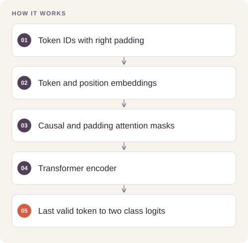

# Sentiment Transformer Architecture

Classify variable-length review token sequences with explicit causal attention and padding behavior.

## Implementation

An independently implemented PyTorch transformer classifier with token/position embeddings, a causal mask, a padding mask, and final-valid-token classification.



## Try a small example

An untrained model checks that right padding leaves the same sequence output unchanged. This is an attention-mask check, not sentiment accuracy.

After the local setup below, run from the repository root:

```sh
python examples/quickstart.py
```

The [example source](examples/quickstart.py), [captured output](examples/expected-output.txt) and [execution record](examples/environment.json) keep this demonstration inspectable. Floating-point values may vary with library versions.

Observed output from this run:

```text
{'logit_shape': [2, 2], 'padding_invariant': True}
```

## Evidence and results

The saved original sentiment experiment reports 82.88% accuracy and loss 0.4483 on 25,000 test reviews, with best validation accuracy 85.92% at epoch 2. These historical figures are retained as experiment evidence; they are not measurements of this new standalone implementation.

This public edition contains a standalone refactor and focused tests. Saved experimental outcomes and the current component checks have separate scopes; the refactor has not been used to recertify the original benchmark.

## Run the checks

Python 3.11 or later.

```sh
python -m venv .venv
source .venv/bin/activate
python -m pip install -r requirements.txt
python smoke_test.py
```

See [DATA.md](DATA.md) for input contracts and [VALIDATION.md](VALIDATION.md) for the verification scope. 

## Practical relevance and limitations

The public architecture has separate shape, gradient, and padding-invariance checks. Its configuration and implementation differ from the historical model, so its accuracy must be measured in a new training run. No pretrained weights, review corpus, or supplied notebook is included.

No client deployment, commercial outcome, or new live-provider performance is inferred from the component tests.
